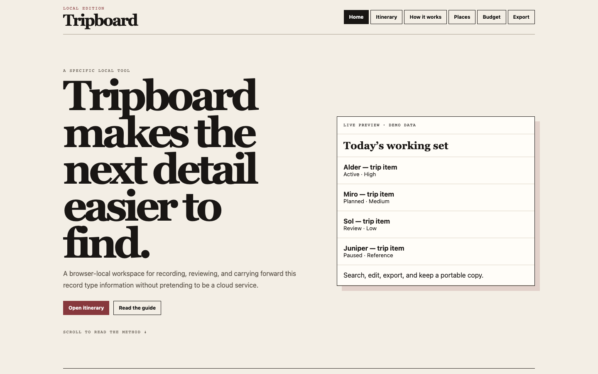
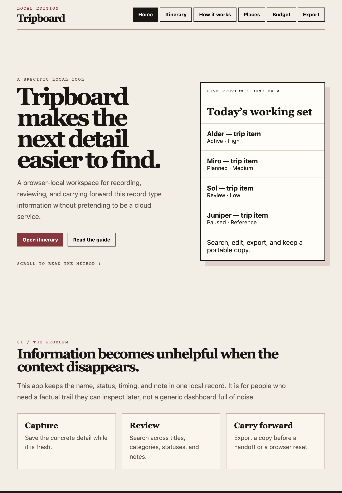
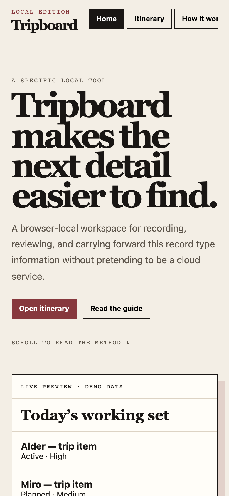

# Tripboard

<!-- screenshots:start -->

  

  
  &nbsp;&nbsp;
  

Mac (1440×900) · Tablet (820×1180) · Phone (390×844)

<!-- screenshots:end -->

A deployable, local-first trip item application. Data is held in browser localStorage.

## Run

Run npm install, npm run dev, npm test, and npm run build. For a production check, run npm run preview after building.

## Deployment

Deploy the generated dist directory to any static host configured to return index.html for client-side hash routes. No server, account, or secret is required.

## Limitations

Local data can be removed with browser storage. Export JSON for a portable backup.

## Main workflow

Open the workspace, review the labelled demo records, add or edit a local record, search it, and export a portable copy when needed.

## Rules

This application is local-first. It does not provide accounts, cloud synchronization, or professional advice. Use verified context before acting on stored information.

## Tests

Run `npm test` for the included logic checks and `npm run build` for the production bundle.

## Future improvements

Potential next steps include richer domain reports, optional encrypted backup files, and more structured import validation.
